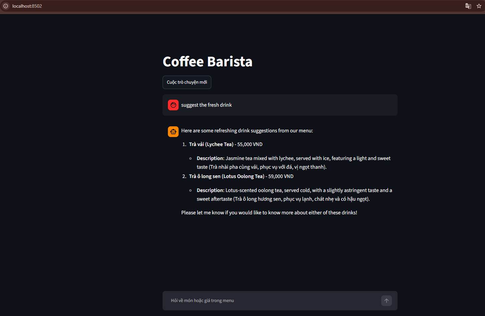
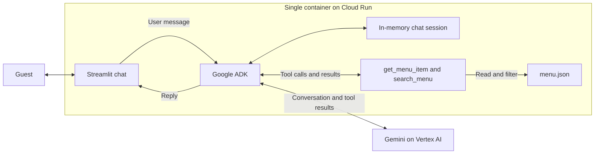

# Coffee Barista Agent

**Help every guest find their next favorite drink.**

A guest knows they want something refreshing under 55,000 VND. Coffee Barista turns that request into a shortlist they can order from, with clear prices and a reason to try each drink. Guests can ask in their own language and follow up with “What does that one taste like?” without repeating the drink name.

- **Find a drink by mood or budget.** Suggest chilled coffee or light, refreshing tea from the menu, with prices in VND.
- **Keep the conversation going.** Answer follow-up questions about a drink and ask for clarification when several options could fit.
- **Give ingredient answers guests can use.** Share ingredients listed on the menu and direct guests to the café for allergy confirmation when ingredient or preparation information is incomplete.

The demo ships with a sample café menu. Swap in your café’s drinks, prices, tasting notes, and ingredient details in [`menu.json`](menu.json).



## Tech stack

| Technology | Role |
| --- | --- |
| Python 3.11 | Validates menu data and runs the lookup and filtering tools. |
| Streamlit | Renders the chat, shows conversation history, and starts new conversations. |
| Google Agent Development Kit (ADK) | Manages in-memory sessions and runs menu tools when Gemini requests them. |
| Gemini on Vertex AI | Interprets requests, selects tools, and writes answers from the returned menu data. |
| JSON | Stores drink names, aliases, categories, prices, descriptions, tags, and selected ingredients. |
| Docker and Cloud Run | Package and host Streamlit, ADK, and the menu together in one container. |

## Architecture



Gemini interprets requests like “something refreshing under 55,000 VND.” ADK calls the Python lookup tools, which apply the requested menu tags and price filters. Gemini then uses those results to write the reply. Chat sessions live in memory and can be lost after a browser refresh, an instance change, or a container restart.

## Run locally

Use Python 3.11, Google Cloud CLI, and a Google Cloud project with billing and the Vertex AI API enabled. Your Google account needs permission to call Vertex AI.

Create a virtual environment, then activate it with `.venv\Scripts\Activate.ps1` in PowerShell or `source .venv/bin/activate` in Bash.

```sh
python -m venv .venv
```

Install dependencies and set up Application Default Credentials (ADC).

```sh
python -m pip install -r requirements.txt
gcloud auth application-default login
gcloud auth application-default set-quota-project YOUR_PROJECT_ID
```

Copy `.env.example` to `.env` and set `GOOGLE_CLOUD_PROJECT`, `GOOGLE_CLOUD_LOCATION`, and `BARISTA_MODEL`. Choose a Vertex AI Gemini model that supports function calling in the selected location.

```sh
python -m streamlit run app.py
```

Open the URL printed by Streamlit. Try “How much is a Latte?” followed by “What does it taste like?” The sample menu lists Latte at 45,000 VND. Select **Cuộc trò chuyện mới** to clear the visible history and start a new ADK session.

## Run tests

```sh
python -m unittest discover -s tests -v
```

The tests use a simulated model with ADK and Streamlit, so they run without Google Cloud credentials. They cover menu lookup, budget limits, invalid menu data, follow-up questions, conversation reset, and retryable failures.

## Deploy to Cloud Run

Run these commands in Bash or Cloud Shell. Replace the example project, region, location, and model values with your own.

```sh
PROJECT_ID=your-project-id
RUN_REGION=asia-southeast1
VERTEX_LOCATION=global
MODEL=your-vertex-gemini-model-id
RUNTIME_SA="coffee-barista@${PROJECT_ID}.iam.gserviceaccount.com"

gcloud services enable run.googleapis.com cloudbuild.googleapis.com \
  artifactregistry.googleapis.com aiplatform.googleapis.com --project "$PROJECT_ID"
```

Create the runtime service account if it does not already exist, then grant it access to Vertex AI.

```sh
gcloud iam service-accounts create coffee-barista --project "$PROJECT_ID"
gcloud projects add-iam-policy-binding "$PROJECT_ID" \
  --member="serviceAccount:$RUNTIME_SA" --role=roles/aiplatform.user
```

The deployer needs Cloud Run Source Developer and Service Usage Consumer permissions, plus Service Account User on the runtime service account. Grant Cloud Run Builder to the build service account. [Cloud Run source deployment permissions](https://docs.cloud.google.com/run/docs/deploying-source-code)

From the project root, check that the source upload includes `Dockerfile`, `app.py`, `requirements.txt`, `menu.json`, and the Python files in `barista/`.

```sh
gcloud meta list-files-for-upload
```

To build the image locally, run `docker build -t coffee-barista-agent .`. The deployment command below builds from the Dockerfile and gives guests public access to the Cloud Run service.

```sh
gcloud run deploy coffee-barista-agent --source . --project "$PROJECT_ID" \
  --region "$RUN_REGION" --service-account "$RUNTIME_SA" --allow-unauthenticated \
  --set-env-vars "GOOGLE_CLOUD_PROJECT=$PROJECT_ID,GOOGLE_CLOUD_LOCATION=$VERTEX_LOCATION,BARISTA_MODEL=$MODEL"
```

Open the service URL and ask for the price of a Latte. The expected answer is 45,000 VND. If the chat shows a retry message, check the Cloud Run logs for the underlying error.
